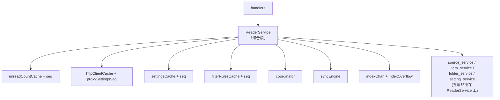
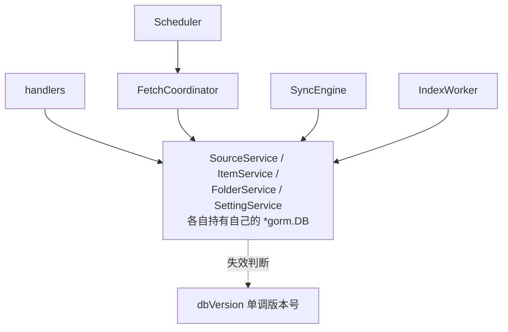

# Hai Razor：Flore 前端功能存在性审查

> 审查方式：从当前代码重新取证，不引用任何历史版本审查文档。证据全部为 `file:line`。

## Verdict

- **Verdict**：replace current shape（核心保留、边界重划）+ merge some + delete some + defer some + prove first
- **一句话理由**：这个项目不缺功能，缺的是**边界**——`ReaderService` 作为"聚合根"实际是 6 层缓存 + 调度 + 同步 + 索引的混合体，`App.tsx` 作为"状态管理中心"实际是 44 个 useState 的平铺；伪需求集中在**未经用户触达的后端路由**和**AI 迁移/兼容脚手架**，而非用户可见功能。
- **使用的剃刀原则**：一个概念只有在被删除后**破坏真实用户/业务目标、丢失真实区分、隐藏重要风险、或把复杂度推给更差的属主**时才配独立存在。仅因"习惯、恐惧、对称性、想象中的未来、审美完整性"存在的，砍掉或合并。

## Audit Scope

- **链条**：前端 `apps/web/src`（App 状态、路由视图、组件、hooks、utils、设置键、类型字段）+ 前端可见的后端契约（`server/go/internal/handlers/reader.go` 路由表 vs `utils/api.ts` 调用集）
- **声称服务的目标**：`docs/architecture/PROJECT.md` 的 7 项核心体验 + "本地优先 / 极简依赖 / 读写分离"三原则
- **未审查（防止误切）**：
  - 后端 service 内部的算法实现质量（filter/readability/proxy_content 的业务正确性）
  - `apps/desktop/`（Wails 壳、更新器、托盘）——本次是前端审查
  - `apps/routing-tool/`（AGENTS.md 明令只读）
  - Go 测试代码的存在与质量
  - UI 视觉质量与无障碍（应走 `ui-design-review`）
  - 仅"代码冗长"的问题（tell #10，不在剃刀范围）

## ⚠ 最高优先级发现：保护栏本身已经失效

`go vet ./internal/services/` **当前失败**：

```
item_service_test.go:116:2: declared and not used: normal
```

这意味着 **`internal/services` 的 8 个测试文件全部没有在执行**，包括 `source_service_test.go:97` 那条断言 `Interval`/`Active` 未被误改的测试——**正是我上面用来保护"删 `Interval` 字段"的那道栏**。

三重叠加，使风险从"需谨慎"升级为"当前不可动"：

1. 8 个 services 测试文件**未编译**（`item_service_test.go:116` 一个未使用变量毁掉整包）
2. `handlers` / `database` / `models` / `backend` / `pkg/paths` **完全无测试文件**
3. `urlpolicy.go` **零测试**——而它是本文档判定为"必须保留的真实信任边界"

**结论**：本审查列为 Delete 的 6 个后端死函数与 3 个模型字段，在测试恢复前**不应动手**。理由不是它们不该删，而是**当前无法证明删除是行为等价的**——这正是 `llm-complexity-tells.md` 行为保持门要求的判定：不能证明等价就不是 Delete，而是 Prove first。

**第一件事不是裁剪，是修好 `item_service_test.go:116`，让 8 个测试文件重新运行。**

### 测试覆盖的真相

| 状态 | 范围 |
|------|------|
| 编译失败 | `services` 全包（8 文件） |
| 通过 | `logging`、`sync`（greader 362 行、miniflux 256 行） |
| **零测试文件** | `handlers`（含全部路由/中间件/CSRF/CORS/限流）、`database`（5 个迁移 + FTS5 建表）、`models`（MilliTime/NullableMilliTime）、`backend`、`pkg/paths` |
| **有文件但零断言目标** | `urlpolicy.go`（SSRF 4 层防护**完全未测**）、`proxy_content.go`、`export.go`、`sync_config.go`（密钥脱敏）、`scheduler.go` |

**最刺眼的一处**：本文档在"Complexity To Preserve"里把 `urlpolicy.go` 列为首位的真实信任边界——SSRF 四层防护里有 DNS-rebinding TOCTOU 消除（`urlpolicy.go:208-243`，解析一次、校验、直连已验证 IP）。这是本项目技术含量最高、最难重建的正确性证明，**而它一行测试都没有**。同样零测试的还有路径穿越（`diagnostic.go:296-301`）、zip bomb（`backup.go:103`）、SQLite 恢复校验（`backup.go:42-79`）。

## ⚠ 第二优先级：一个用户可见的开关完全不生效

`SettingsNotifyTab.tsx:50-51` 提供「显示托盘图标」开关，写入 `settings.trayEnabled`，但：

```
grep trayEnabled  →  settings.ts:153,229  +  SettingsNotifyTab.tsx:50,51   （仅此 4 处）
apps/desktop/*.go →  0 命中
```

桌面壳**无条件**调用 `a.startTray()`（`apps/desktop/app.go:255`），从不读该键。

**这与我判为"功能过多"的 `Source.active` 恰好相反**：那里是后端保护了功能却缺 UI 入口；这里是 UI 给了开关但功能压根不接线。用户在设置里关掉托盘，重启后托盘还在——**这是 bug，不是过度设计**。

同类的还有 `faviconMode`：前端 UI 可改（`SettingsNetworkTab.tsx:77-84`），后端 `reader.go:97` 只在 `loadProxySettingsSeq` 读 `proxyEnabled`，**从不读 `faviconMode`**——它的消费完全在前端 `SourceAvatar.tsx:29`，而那里用 `useState(() => getCachedSettings())` 做了**一次性快照**，用户改设置后不生效。

**结论**：设置面板里有 2 个键处于"UI 可改、语义无效"状态（`trayEnabled` 完全不消费；`faviconMode` 被快照冻结）。这不是砍功能，是**接线缺失**。

## ⚠ 第三优先级：三处"看起来存在、实际不可达"的 UI

| 现象 | 证据 | 性质 |
|------|------|------|
| toast 的 `success`/`error` 类型分支不可达 | 全库 122 处 `showToast(` 调用，**0 处**传第二个参数；但 `ToastContainer.tsx:6-10` 有 success/error 图标分支 | 死代码，但**低成本高价值**：这是 UI 该有的反馈分级。补 `showToast(msg,'error')` 即可激活 |
| 阅读器空态提示「按 J / K 上下浏览」，但**没有绑定 J/K** | `Reader.tsx:549` 文案；`App.tsx:366-370` 只绑 `ArrowDown`/`ArrowUp` | **文案说谎**。要么绑 J/K，要么改文案 |
| `icons.tsx:97-136` 别名块几乎全死 | 抽样验证 `PlusIcon`/`CheckIcon`/`TrashIcon`/`LoaderIcon`/`GlobeIcon` 均 **0 外部引用** | 38 个死别名。注意：Sidebar 用的是原名 `Plus`，**原名仍在用，死的是别名层** |

## Evidence

| Source | 看到了什么 | 支撑/削弱哪个裁决 | 置信度 |
|--------|-----------|------------------|--------|
| `grep trayEnabled` 仅 4 处；`apps/desktop/*.go` **0 命中** | UI 开关完全不生效，托盘无条件启动 | **Replace → 补接线**（非删功能） | 高（已验证） |
| `App.tsx:366-370` 无 `case 'j'/'k'` | `Reader.tsx:549` 的 J/K 提示文案与实现不符 | **Replace** 修文案或绑键 | 高（已验证） |
| 122 处 `showToast(` 调用 **0 处**传类型 | `ToastContainer.tsx:6-10` 的 success/error 分支不可达 | **Keep 分支 + Delete 参数** | 高（已验证） |
| `icons.tsx` 5 个别名抽样 **0 外部引用** | 别名层是冗余层 | **Delete 别名块**，保留原名 re-export | 高（已验证） |
| `App.tsx:121-122` 解构 `setFolders`/`setUnreadCountInScope`/`loadingSources` 未用 | hook 返回值有 3 项无人消费 | **Merge/Trim** | 高 |
| `usePlatform` 的 `isWindows`/`isLinux` | 无消费者 | **Delete 返回值** | 高 |
| `api.ts` 的 `getCachedUpdate`/`getUpdateProgress` | `useUpdate.ts` import 了但未调用 | **Delete** | 高 |
| 4 处独立的未读数计算（`App.tsx:262`、`Sidebar.tsx:69`、`useSourcesData.ts:58`、`ArticleList.tsx:326`） | 同一语义 4 份实现 | **Merge** | 高 |
| `OnboardingWelcome.tsx:20-26` 一键订阅硬编码 `interval:30` + `listRule:'show'` | **绕过 `settings.defaultInterval`**，且写入的 `listRule` 值与后端约定的 `'rss'` 不同 | **Replace** | 高 |
| `go vet ./internal/services/` **失败** | `item_service_test.go:116:2: declared and not used: normal` → 8 个测试文件全未执行 | **推翻所有后端 Delete 裁决的执行时序**，改为 Prove first | 高 |
| `urlpolicy.go` 零测试 | SSRF 4 层（含 TOCTOU 消除）无任何测试 | 强化"必须保留"，同时揭示**保护栏缺失** | 高 |
| `handlers`/`database`/`models`/`backend` 无测试文件 | — | 同上 | 高 |
| `App.tsx:113-144` | 24 个顶层 useState 平铺，无 reducer、无状态机、无领域分组 | 支撑 Replace(App 状态组织) | 高 |
| `App.tsx:353-362` vs `:981-1072` | 9 个弹窗 state 各占 1 行 + 各 1 个 JSX 块，无通用 Modal 控制器 | 支撑 Merge(弹窗族) | 高 |
| `server/go/internal/handlers/reader.go:184-303` | 约 70 条路由注册 | 基准 | 高 |
| 对 `api.ts` 逐条反查 | **18 条路由前端零调用**（详见 Razor Map） | 支撑 Delete/Prove-first | 高 |
| `settings.ts:101-247` | 43 个 AppSettings 键 | 基准 | 高 |
| 对 43 键逐条反查 | **43 键全部有 UI 或后端消费点，无死键**（含 `dimRead`←`ArticleList.tsx:660`、`markReadHoverDelay`←`:577`、`faviconMode`←`SourceAvatar.tsx:27`） | 削弱"设置键过度设计"的假设；真正问题在键的**平铺无分类**与 legacy 迁移脚手架 | 高 |
| `services/reader.go:15-57` | ReaderService 持有 unreadCount/httpClient/settings/filterRules **4 套独立 seq 缓存** + coordinator + syncEngine + 2 个索引 channel | 支撑 Replace(服务边界) | 高 |
| `models.go:49-51` | `NextCheckAtUnix` 自注"遗留字段（不再写入）…保留列避免迁移风险" | 支撑 Delete(列) | 高 |
| `models.go:18` | `ListRule` 全代码库仅写入 `"rss"`/… 无分支消费，仅测试里赋值 | 支撑 Delete(字段) | 高 |
| `models.go:19` | `Interval` 写入口存在但 `scheduler.go:10-14` 明注"全局轮询周期"，前端 `settings.defaultInterval` 才是真调度源 | 支撑 Delete(字段) 或 Replace | 高 |
| `settings.ts:250-303` + `:443-461` | 4 个 `migrate*` 函数 + `MIGRATION_KEY` 一次性迁移，对应 `markOnScroll/hover/view`、`hidePrivate`、`readerTheme:light/dark`、`loadOnlineAvatar` — 均来自 routing-tool 的 Prisma 历史或更早版本 | 支撑 Delete 或 Defer | 高 |
| `types.ts:32-52` | SyncConfig 18 字段，其中 file* 8 个（S3/WebDAV） | 需核实是否可达 | 中 |
| `types.ts:11-28` | `remoteOrigin/remoteId` 前端 types 声明但**零消费**（grep 只命中 types.ts 自身） | 支撑 Delete(前端声明) | 高 |
| `models.go:73` + `item_service` | `Item.Source` GORM 关联字段 `json:"source,omitempty"` — 列表接口是否真的 preload？ | 待验证 | 低 |

## Razor Map

### A. 前端：路由 / 视图

| Concept | 声称目的 | 删除后具体破坏什么 | 隐藏属主 | 裁决 | 理由 |
|---------|---------|------------------|---------|------|------|
| 路由系统（react-router 等） | 页面导航 | **不存在**——项目根本没有路由库，视图靠 `selectedSourceId/selectedFolderId/filter/selectedItem` 组合切换（`App.tsx:113-139`） | — | **Delete（不存在项）** | 审查前需澄清的前提：不要为"缺路由"而补路由 |
| 移动端 `mobileView` 双视图 | <768px 时列表↔阅读互斥 | 真实区分：窄屏无法三栏并排（`App.tsx:156-168, 918-965`） | — | **Keep** | 删除即窄屏不可用 |
| `isMobile` JS 断点 vs CSS | — | 两者并存导致条件渲染分叉 | — | **Replace** | 应统一为 CSS media query + 一个 `matchMedia` hook，而非 resize 监听 + 条件 class 混用（`App.tsx:156-168`） |
| `OnboardingWelcome` 空状态引导 | 首次启动 | 真实目标：零源用户需要 OPML/加源入口（`App.tsx:909-914`） | — | **Keep** | 真实首次运行场景 |
| `RECOMMENDED_SOURCES`（`data/recommended-sources.ts`） | 引导期一键订阅 | 真实区分：新用户无需自己找 feed | — | **Prove first** | 18 行静态列表，硬编码第三方源；无使用数据。需证明有多少用户真的用它，而非绕过 OPML 导入 |

### B. 前端：状态管理

| Concept | 声称目的 | 删除后具体破坏什么 | 隐藏属主 | 裁决 | 理由 |
|---------|---------|------------------|---------|------|------|
| `App.tsx` 集中状态（44 state） | 全局唯一数据源 | 删除状态 → 无应用。但**当前组织方式**是问题 | — | **Replace** | 状态本身必需（`fetchersRef:463` 证明存在跨回调一致性需求），但 24 个平铺 useState + 5 套 `Ref.current` 手工同步（`itemsRef:329`、`foldersRef:533`、`fetchersRef:463`、`keyboardHandlerRef:446`）是典型的"手工 memo 化"负担。应改为按领域分组（navState / listState / readerState / modalState）或 reducer，而非继续加 ref |
| `keyboardHandlerRef` + `fetchersRef` + `itemsRef` + `foldersRef` | 避免重注册/闭包过期 | 删除 → 事件监听器每帧重注册，或读到过期闭包 | — | **Replace** | 这是 React 19 `useEffectEvent` 之前的手写替代。**若继续加第 5、第 6 个此类 ref，说明该换机制而非加 ref** |
| `multiSelectMode` + `selectedIds` | 批量标记已读 / 批量导出 | 真实区分（`ArticleList` 多选条） | — | **Keep** | 有 API 端点支撑（`api.ts:353`） |
| `isSearchMode` + `searchKeyword` 双状态 | 搜索态 | 二者可互相推导：`isSearchMode === searchKeyword !== ''` | — | **Merge** | 双 state 可产生非法组合（keyword 有值但 mode=false），是一个潜在无效状态（`useItemsData.ts:58-59`） |
| `filter`（4 值）+ `selectedSourceId` + `selectedFolderId` | 列表范围 | 真实区分 | — | **Keep**（但应验证互斥） | `isFilterActive:290` 手工判断三者关系，说明可能同时生效 |
| `showCreateFolder` + `createFolderName` 内联 ModalLayout | 新建文件夹 | 与 `RenameModal` 是同一形态 | `RenameModal` | **Merge** | `App.tsx:1050-1072` 手写了一个 `ModalLayout`，而 `RenameModal` 已有同形态组件可复用 |
| 9 个弹窗 boolean state | 弹窗可见性 | 真实 | — | **Merge** | 应收敛为单一 `activeModal: {type, payload} \| null`，消除 9 个互斥 boolean 组合爆炸（`App.tsx:127-134, 144`） |

### C. 前端：组件

| Concept | 声称目的 | 删除后具体破坏什么 | 隐藏属主 | 裁决 | 理由 |
|---------|---------|------------------|---------|------|------|
| `MoveSourceModal` | 移动源到文件夹 | 真实功能，但 `EditSourceModal` 已含文件夹选择（`App.tsx:999-1004` 传 `folders`） | `EditSourceModal` | **Merge** | 两个弹窗做同一件事（选目标文件夹），后者是超集 |
| `RenameModal` 通用化 | 文件夹/源重命名 | — | — | **Keep** | 已正确泛化（`renameTarget.type` 分派） |
| `ModalLayout` | 通用弹窗布局 | — | — | **Keep** | 但 `App.tsx:1051` 只用一次却绕过了 `RenameModal` |
| `ModalLayout` / `ConfirmDialog` / `Button` / `IconButton` / `EmptyState` / `Loading` | 基础 UI | 真实复用 | — | **Keep** | 有实际引用（`Reader.tsx:546` EmptyState 等） |
| `ThemeToggle` | 深浅色切换 | `grep ThemeToggle` 全库**仅命中自身文件**，无任何 import | — | **Delete** | 死代码（本报告唯一确认的死组件）。主题切换已内联在 `SettingsAppearanceTab` |
| `icons.tsx` re-export 层 | 统一图标入口 | — | — | **Keep** | AGENTS.md §5.2 明文约束，是有意的边界 |
| `usePlatform` | 统一平台判断 | `Sidebar.tsx:148` + `TitleBar.tsx:168` 两处消费 | — | **Keep** | 已完成合并（AGENTS.md 称其取代各组件内 state，证据支持） |
| `useBackups` | 备份列表状态 | `SettingsDataTab.tsx:44` 消费 | — | **Keep** | |
| `useUpdate` + `UpdateBadge` | 更新流程 | 桌面端真实 | — | **Prove first** | 3 状态开关 + 7 个 Wails 绑定方法 + 独立 `updatelet` 包（git 未跟踪）。需证明桌面端用户真的在用应用内更新 |
| `ExportArticlesModal` | 批量导出 md/json | 真实 | — | **Keep** | |
| `ShortcutsHelpModal` | 快捷键说明 | 真实（`?` 触发，`App.tsx:402-405`） | — | **Keep** | |
| `useClickOutside` | 点击外部关闭 3 个下拉 | `ReaderToolbar.tsx:124-126` 三处消费 | — | **Keep** | 抽取正确，消除了三份重复监听 |
| `Loading` / `EmptyState` | 基础 UI | `Reader.tsx:538,593,629`、`ArticleList.tsx:427`、`Reader.tsx:546` 多处消费 | — | **Keep** | |
| `SavePNGFile` / `blobToBase64` | 导出文章为 PNG | `Reader.tsx:372-380` 用动态 import 消费（已做包体优化，`避免 html2canvas 拖累初始包体积`） | — | **Prove first** | 截长文章为 PNG 是典型"功能堆砌"，但实现方已做了懒加载与桌面/双端保存桥接，成本感知明确。需证明用户真的用它而非复制文本 |
| `getFaviconDirectBase` / `faviconMode: 'direct'` | 源站直抓 favicon | `SourceAvatar.tsx:43` 消费，但模式在 `SourceAvatar.tsx:27` 用 `useState` **一次性快照**，用户改设置不生效 | — | **Replace** | 机制错误：`useState(() => getCachedSettings().faviconMode)` 冻结了首值。应为响应式读取。**且后端不读 `faviconMode` 键**（grep 0 命中），消费全在前端 |
| `trayEnabled` 设置键 | 显示/隐藏系统托盘 | **UI 可改但不生效**：`apps/desktop/*.go` 0 命中该键，桌面壳 `app.go:255` 无条件 `startTray()` | — | **Replace（接线）或 Delete（键）** | 用户可见 bug：关掉开关托盘仍在。要么桌面壳读它，要么删掉这个设置项 |
| toast 的 `type` 参数（`toast.ts:69`） | success/error 反馈分级 | **122 处调用 0 处传参**，`ToastContainer.tsx:6-10` 分支不可达 | — | **Replace** | 参数与分支是"想象中的 API"，但**意图正确**（错误 toast 应区别于信息 toast）。保留分支，让错误路径真正传 `'error'` |
| `favicon-proxy`（Yandex 第三方服务） | 图标代理 | 引入**第三方服务依赖 + 用户 IP 外泄**；且**默认已是 off**，后端从不读该键 | — | **Delete 或 Prove first** | 本地优先应用把 favicon 请求发给 Yandex，与 `PROJECT.md` 隐私定位冲突。默认关闭 + 无消费 = 一条孤儿路由 |
| `icons.tsx` 别名块（`:97-136`，约 30 个） | 图标别名 | 抽样 5 个全部 0 外部引用；**原名仍被使用**（Sidebar 用 `Plus` 而非 `PlusIcon`） | — | **Delete 别名块** | 典型 tell #2：为不存在的第二个消费者预留的命名层。保留原名 re-export（AGENTS.md §5.2 约束仍成立） |
| `usePlatform` 的 `isWindows`/`isLinux` | 平台判断 | `Sidebar.tsx:148` 用 `isMac`，`TitleBar.tsx:168` 用 `isMac`；`isWindows`/`isLinux` 无消费者 | — | **Delete 返回值** | 单实现变体（当前只分 Mac / 非 Mac）。加第三个返回值时应连同真实分支一起加 |
| `api.ts` 的 `getCachedUpdate`/`getUpdateProgress` | 读更新缓存/进度 | `useUpdate.ts` import 后**未调用**（只调 check/start/confirm/snapshot） | — | **Delete** | 状态实由 `EventsOn(updateStateEvent)` 推送（`useUpdate.ts:49-56`），这两个拉取式 API 是被事件流取代的旧机制残留 |
| `useUpdate` 的 check/download/restart | 更新动作 | 对 `api.ts` 的 1:1 try/catch 透传 | — | **Merge** | 透传层无价值；调用方直接用 `api.ts` 即可。但 `ready` 派生（`:63-69`）应保留 |
| `App.tsx:121-122` 的 `setFolders`/`setUnreadCountInScope`/`loadingSources` | 解构出的 setter | 全文件无第二处出现 | — | **Delete（解构）** | hook 仍应返回（自有内部用），但 App 不必解构 |
| 4 处独立的未读数计算 | 显示未读数 | `App.tsx:262-270`（本地 delta）、`Sidebar.tsx:69-87`（递归求和）、`useSourcesData.ts:58-76`（后端 count）、`ArticleList.tsx:326-348`（混合） | — | **Merge** | 同一语义 4 份实现，是最易静默不一致的一类重复（列表数 / 侧栏数 / 标题数对不上） |
| 两份 OPML 导出实现 | 导出订阅 | `App.tsx:804-811`（直接 downloadBlob）vs `SettingsModal.tsx:319-331`（先试 Wails SaveOPMLFile） | — | **Merge** | 行为**有差异**：设置里的导出会走原生保存对话框，侧栏的不走。同一功能两个语义 |
| 两份快捷键表 | 快捷键说明 | `ShortcutsHelpModal.tsx:8-18` vs `SettingsShortcutsTab.tsx:6-26` | — | **Merge** | 同一组键位两份描述，加键必漏改一处 |
| `escapeRegExp` × 2、`resolveSrc`/`buildProxyUrl` × 2（同一文件内） | 正则转义 / 代理 URL 构造 | `ArticleList.tsx:494` vs `Reader.tsx:221`；`Reader.tsx:90-108` vs `:175-201` | — | **Merge** | 同一份实现复制两遍，提到 `lib/` |
| `RuleTestModal.tsx:6-13` 的 `isSafeLink` | http/https 校验 | 与 `api.ts:135-158` 的 `openExternal` 白名单是第三份 | — | **Replace** | 统一走 `openExternal` |
| `OnboardingWelcome.tsx:20-26` 一键订阅 | 快速订阅 | 硬编码 `interval:30`（绕过 `settings.defaultInterval`）+ `listRule:'show'`（后端约定值是 `'rss'`） | — | **Replace** | 绕过 `AddSourceModal` 的 `autoGroup` 逻辑，导致首启路径与正常添加路径行为不一致 |
| `Reader.tsx:549` 「按 J / K 上下浏览」 | 空态提示 | **无 J/K 绑定**（`App.tsx:366-370` 只绑 ArrowUp/Down），已验证 | — | **Replace** | 文案说谎。用户照做无反应 |
| `Source.interval`（前端 types 声明） | — | 前端 **0 处**读取 Source 实例的 `interval`；`AddSourceModal` 的 `form.interval` 是自己的表单字段 | — | **Merge** | 前端确实**发送** `interval`，但从不读取——与后端 `Interval` 字段同病：只写不读 |

### D. 前端：数据字段（TypeScript types）

| Concept | 声称目的 | 删除后具体破坏什么 | 隐藏属主 | 裁决 | 理由 |
|---------|---------|------------------|---------|------|------|
| `Source.listRule` | 列表规则 | 删字段 → 后端 `models.go:18` 需同步删（not null 列需迁移） | — | **Delete** | 全库零分支消费，只在创建时写死 `"rss"`。纯 Prisma 继承字段 |
| `Source.interval` | 单源轮询间隔 | `coordinator.go:165` 用 `WHERE active = true` 全量提交，不按 interval 过滤；`scheduler.go` 用全局 `defaultInterval` | `settings.defaultInterval` | **Delete 或 Replace** | 字段存在但**不驱动任何调度**。前端无入口（grep 0 命中）。要么接回调度器，要么删 |
| `Source.active` | 启用/停用源 | `coordinator.go:165,225` **真实消费**（`WHERE active = true`） | — | **Keep**（字段） / **Prove first**（UI 入口） | 后端保护了僵尸源不被抓取，但**前端零入口设置它**（grep `.active` 0 命中）。用户无法关闭一个吵闹的源 — 这是真实功能缺失，非过度设计 |
| `Source.remoteOrigin` / `remoteId`（前端 types） | 标识远端同步来源 | grep 命中**仅 types.ts 自身**，前端零消费 | `sync_engine.go`（后端自用） | **Delete（前端声明）** | 纯冗余声明 |
| `Item.author` / `Item.desc` | 作者/摘要 | `ArticleList.tsx:622` 消费 desc | — | **Keep** | author 需二次确认消费点 |
| `SyncConfig.file*` 8 字段（S3/WebDAV） | 文件后端同步 | 需证据 | `sync_config.go:68-77` | **Prove first** | 8 字段 + `sync_engine.go:251-272` 一整套 WebDAV 客户端。若无真实用户 → 整块 Delete |
| `ItemWithSource.SourceFolderID` | 过滤器 scope 匹配 | `reader.go:197,216` 消费 | — | **Keep** | filter scope 需要 |
| `Item.Source` GORM 关联 | 预加载源 | `json:"source,omitempty"` 若 preload 会随列表返回冗余对象 | — | **Prove first** | 需验证 `GetItems` 是否真的 preload；若 preload 则 N+1/冗余，若不 preload 则该字段是死声明 |

### E. 前端：设置键（AppSettings 43 项）

| Concept | 声称目的 | 删除后具体破坏什么 | 隐藏属主 | 裁决 | 理由 |
|---------|---------|------------------|---------|------|------|
| 43 个设置键 | 全面可配置 | — | — | **Replace（分层）** | 全平铺无分类语义。实为三类：**真偏好**（density/font/sort）、**触发策略**（autoFetchOnStart/unreadOnStart）、**基础设施**（proxy/fetchTimeout/fetchConcurrency）——后者不该由用户调 |
| `initialFetchWindowDays` | 首次抓取窗口 | `fetcher.go:151` **后端真实消费** | — | **Keep** | 有真实行为 |
| `closeBehavior` / `minimizeBehavior` / `trayEnabled` | 窗口行为 | `saveSettings.ts:435` 调 `RefreshWindowSettings` 真实消费 | — | **Keep** | |
| `updateAutoDownload` | 检测到更新自动下载 | 需证据 | — | **Prove first** | 默认 false；下载 ~100MB 无人值守下发，是典型"想象中的需求" |
| `backupAutoInterval` / `backupMaxDays` / `backupMaxKeep` | 备份策略 | `BackupPolicyForm.tsx` 消费 | — | **Prove first** | 4 个旋钮管一件事：自动备份。需证明用户需要调 vs 默认合理 |
| `migrateMarkReadMode` / `migrateHidePrivate` / `migrateReaderTheme` / `migrateLegacySettings` + `MIGRATION_KEY` | 旧版兼容 | 对应 4 组已废弃键 | — | **Delete 或 Defer** | 这些迁移源自 routing-tool 的 Prisma 历史。项目是**新**的、无存量用户。若保留，唯一理由是"已发过版"。需明确：Flore 是否已对外发布？ |
| `migrateReaderTheme: 'light'/'dark' → 'paper'` | 主题迁移 | 源键值 `'light'/'dark'` 是否真存在过 | — | **Prove first** | 需 git log 证据 |
| `ENUM_VALIDATORS` + `coerceSettingValue` | 设置损坏防护 | 设置来源含 localStorage + **后端 API**（`loadSettingsFromServer:346`） | — | **Keep** | 后端可被其他客户端写入，`String(value)` 反序列化（`settings.ts:407`）确实会产出 `true`→`"true"`、数字→字符串。这是**信任边界**，非过度防御 |
| `isReadLater` 同步缺口 | 状态回推 | **发现**：`StateChangeKind`（`provider.go:70-79`）只覆盖 read/star；`MarkReadLater`（`item_service.go:182-184`）从不调 `RecordStateChange`；`upsertRemoteItems` 更新分支（`sync_engine.go:671-682`）也不写 `isReadLater` | — | **Prove first** | 稍后阅读标记**不会同步到远端**。可能有意（GReader 协议无此概念）也可能是缺口——若是缺口，这是"功能不足"而非"功能过多"，与剃刀方向相反，单独记录 |
| `getCachedSettings` + `storage` 事件监听 | 高频读性能 | — | — | **Merge** | `settings.ts:330-342` 的模块级缓存 + 全局 listener，只为省 `JSON.parse(localStorage)`。可被 `App.tsx` 的 state 直接替代（组件已通过 props 收到 settings） |

### F. 后端契约：路由存在性（前端零调用的 API）

> **重要更正**：我起初只反查了 `apps/web/src/utils/api.ts`，这会产生假阳性。经补查 `apps/desktop/`（Wails 壳），以下路由**有真实非前端调用方**，必须从裁剪清单中移除：
> - `GET /api/settings/:key` ← `apps/desktop/window.go:31`（壳读取窗口行为设置）
> - `GET /api/sources/fetch-status` ← `apps/desktop/notify.go:38`（托盘通知轮询）
> - `POST /api/sources/fetch-all` ← `apps/desktop/systray.go:174`（托盘"立即刷新"）
> - `GET /api/database/export` ← `apps/desktop/dialog.go:220`（原生保存对话框流式导出）
>
> 教训：这个项目有**两个前端**。任何"某 API 无人调用"的结论必须先查 `apps/desktop/`。

> 以下路由已在 `reader.go` 注册，但前端 `api.ts` **与** `apps/desktop/` **均无调用点**。**这是本次审查最集中的伪需求区域。**

| Concept | 声称目的 | 删除后具体破坏什么 | 隐藏属主 | 裁决 | 理由 |
|---------|---------|------------------|---------|------|------|
| `POST /items/read-later/clear` (`:219`) | 清空稍后读 | 无 UI 入口 | — | **Delete 或 Prove first** | 稍后阅读有计数、有视图，唯独没有"清空"入口。要么加 UI，要么删路由 |
| `POST /items/:id/index-search` (`:223`) | 单篇重建索引 | 批量版已有（`:224`） | — | **Merge** | 保留 rebuild，删单篇版 |
| `POST /items/:id/apply-filters` (`:228`) | 手动应用规则 | 规则有 test 端点但无 apply | — | **Delete 或 Prove first** | 前端与桌面壳均无调用 |
| `GET /items/:id` (`:212`) | 文章详情 | 列表已返回完整 Item | — | **Delete** | 纯冗余 REST 完备性 |
| `GET /sources/:id` (`:187`) | 单源查询 | 前端只用 `/sources` 全量 | — | **Delete** | 同上 |
| `POST /sources/:id/read-all` (`:194`) | 源下全部已读 | 前端用通用 `/items/read-all` + scope，**功能重叠** | — | **Delete** | 两个端点做同一件事 |
| `GET /settings/:key` (`:291`) | 单 key 读 | **有调用方**：`apps/desktop/window.go:31` | — | **Keep** | 上节已更正 |
| `GET /cache/stats` / `clear-readability` / `rebuild-search` (`:266-268`) | 缓存管理 | 无 UI | — | **Delete 或 Prove first** | 与 `/items/index-search/rebuild` **重复**（两个 rebuild 端点） |
| `POST /database/vacuum` (`:269`) | VACUUM 压缩 | 无 UI | — | **Delete 或 Prove first** | |
| `GET /database/info` (`:265`) | DB 文件信息 | 无 UI | — | **Delete** | |
| `GET /diagnostic/*` (`:297-299`) | 诊断包 | 无 UI；用户报告 bug 时需要 | — | **Prove first** | 用户实际报障路径。保留但需 UI 入口，否则是"为 imagined operator 设计" |
| `POST /shutdown` (`backend.go:126`) | 优雅关闭 | **桌面壳在用** | — | **Keep** | |
| `GET /health` (`:306`) | 健康检查 | 桌面壳轮询 | — | **Keep** | |
| `GET /items/:id/export.md` (`:227`) | 单篇 Markdown | **有调用方**：`contextMenu.ts:16,35,52`（右键"导出 Markdown"） | — | **Keep** | 我第一遍只查 `api.ts` 时误判为 Prove first |
| `GET /css-proxy` (`:253`) | CSS 代理 | **无调用方**：`RewriteCSSUrls`（`proxy_content.go:148,163`）只产出 `/image-proxy` URL，从不产出 css-proxy 地址 | — | **Delete** | 前端不引用它，后端自己的重写器也不产出它。整条路由是孤儿 |
| `GET /stats/unread` (`:258`) | 未读统计 | 前端用 `/items/count` 实现（`useItemsData.ts:100-118`） | — | **Delete** | 与 `/items/count` 功能重叠 |
| `GET /backups/:name/contents` (`:279`) | 读取备份内容 | `importBackup`（`api.ts:625`）已内联返回 `BackupEntry` | — | **Delete** | |
| `GET /health`（无 `/api` 前缀，`reader.go:306-308`） | 桌面壳健康检查 | `backend.go:300` 轮询 | — | **Keep** | 但注意：**该路由无任何中间件**（不在 `api` 组内，无限流、无 CSRF） |

### G. 后端：模型字段

| Concept | 声称目的 | 删除后具体破坏什么 | 隐藏属主 | 裁决 | 理由 |
|---------|---------|------------------|---------|------|------|
| `SourceHealth.NextCheckAtUnix` (`:51`) | 自适应调度到期时间 | **代码自己说"不再写入…保留列避免迁移风险"** | — | **Delete** | 自认死字段，且 `migrateV3NextCheckAtUnix` 的唯一作用是推进版本号。SQLite 删列成本低（AGENTS.md 已把表结构变更定为 MAJOR） |
| `Source.ListRule` (`:18`) | — | 见 D 区 | — | **Delete** | |
| `Source.Interval` (`:19`) | — | 见 D 区 | `settings.defaultInterval` | **Delete** | |
| `Folder.ParentID` (`:7`) | 嵌套文件夹 | 前端 **0 命中 parentId**；UI 无"移入文件夹"入口；创建只传 name | `folder_service.go` 有子文件夹提升逻辑 | **Prove first** | 后端支持任意深度 + 删除时子文件夹提升，但**前端无法创建嵌套**。要么加 UI，要么砍到平铺 |

### H. 后端：服务边界

| Concept | 声称目的 | 删除后具体破坏什么 | 隐藏属主 | 裁决 | 理由 |
|---------|---------|------------------|---------|------|------|
| `ReaderService` 作为"聚合根" | 统一入口 | **这是本次最重的 Replace 目标** | — | **Replace** | 见 Before/After |
| `execLocked` (`:119`) | 持锁执行 SQL 防 db 关闭竞态 | `ExportDatabase/Backup/Vacuum` 与并发 import 竞态 | — | **Keep** | 有注释记录的 m-03 真实竞态修复，非防御性冗余 |
| `indexChan` + `indexOverflow` + `indexWorker` + `indexDrainer`（4 个构件） | 批量索引不阻塞抓取 | 抓取吞吐 | — | **Keep（但合并）** | 解决真实性能问题；4 个构件是必要的，但 `indexWorker` 的 `goto process` 标号流程（`:141-162`）值得单独简化（非本审查范围） |
| 4 套独立 seq 缓存（`unreadCount`/`httpClient`/`settings`/`filterRules`） | 避免重复查询 | 若合并为单一"数据版本号"缓存层 | — | **Merge** | 4 套 seq + 4 套 mutex 是同一问题的 4 次实现。DB 单写者（`SetMaxOpenConns(1)`）下，一个 `dbVersion uint64` + 各缓存记版本即可 |
| `internal/sync/provider.go` `RemoteProvider` 接口 | 双 provider 抽象 | GReader(449行) + Miniflux(192行) 两个真实实现 | — | **Keep** | 两个真实实现，接口**不是**单实现套壳 |
| `sync.FileProvider` 接口（`provider.go:173-185`） + `ReaderPackage/PackageFolder/PackageSource/PackageItem`（`:131-170`） | 文件后端抽象 | **零实现**。WebDAV 是引擎内直接 `PROPFIND`（`sync_engine.go:266-295`），不走接口 | — | **Delete** | 教科书式 tell #3：为不存在的第二实现预留的抽象层。`FileProvider` 无任何 implementer |
| `ProviderTTRSS` 常量（`provider.go:13-17`） | 第三种 provider | grep 全库仅命中声明本身 | — | **Delete** | 想象中的 provider，零实现零引用 |
| `ErrUnsupported`（`provider.go:20`） | 能力协商 | 唯一生产者 `miniflux.go:87`，唯一消费者是测试断言 | — | **Replace** | 意图正确（Miniflux 不支持 OpRename/OpMove，`miniflux.go:86-87`），但**引擎侧无任何能力检查**，返回值无人看。要么接上协商，要么删 |
| `computePullSince` 的 GReader 特判（`sync_engine.go:226`，常量 `greaderFullPullEvery=10`） | provider 差异化拉取频率 | 硬编码 `provider.Name() != ProviderGReader` | — | **Replace** | 接口抽象漏了点：频率策略应作为 provider 的自述属性（如 `FullPullEvery() int`），而非引擎里的名字比较 |
| `MoveSourceFolder`（`folder_service.go:54`） | 移动源到文件夹 | 全库唯一调用方是测试 `folder_service_test.go:110` | `PUT /sources/:id` + `folderId`（`source_service.go:175`） | **Delete** | 真实功能已由 UpdateSource 承担；这是重复实现，且**只为它写了测试** |
| `setDb`（`reader.go:109`） | 恢复数据库后更新 db 引用 | 零调用方——恢复路径直接 `s.db = database.GetDB()`（`backup_restore.go:80,87,94,101,136`） | — | **Delete** | 绕过封装的死方法 |
| `applyFiltersAndIndex`（`fetcher.go:625`） | 同步应用规则+索引 | 零调用方，已被 `upsertFeedItems:517-529` 的异步 indexChan 路径取代 | `indexBatch`（`reader.go:173`） | **Delete** | 已知被取代 |
| `FetchReadability`（`readability.go:194`）/ `ProxyOriginal`（`:246`） | 便捷包装 | 零调用方，实际走 `WithClient` 变体 | — | **Delete** | 两个包装的唯一意义是路由到包级 `readabilityHTTPClient`（`:175`），该变量因此也只被这两个死函数可达 |
| `compressToZip`（`backup.go:311`） | 压缩备份 | 零调用方，已被 `compressToZipFull:340` 取代 | — | **Delete** | |
| `GetBackupContents` 路由（`/backups/:name/contents`） | 读取备份内容 | 前端 `importBackup` 已内联返回（`api.ts:625`） | — | **Delete** | |
| `ApplyFilterRules`（`filter.go:227`）与 `indexBatch` 内联规则应用 | 应用过滤规则 | 两者都用同一组 `ruleMatchesScope`/`ruleMatchesConditions`/`applyRuleAction`，是**同一套规则的两个独立 applier** | — | **Merge** | 必须保留一个（规则真实性无疑），但两份实现会漂移。**注意**：`ApplyFilterRules` 只被那条零调用的 `/items/:id/apply-filters` 路由使用，删路由后它自然只剩 `indexBatch` 一条路径 |
| 作用域/时间线过滤的三份实现 | 列表范围过滤 | `buildItemQuery`（`item_service.go:15`）、`applyCountScopeFilters`（`:229`）、`buildExportQuery`/`applyScopeFilter`（`export.go:48,67`）三处各自实现文件夹递归展开 + hidePrivate | — | **Merge** | 同一语义三份拷贝，任一改动漏改即造成"列表与计数不一致"或"导出范围不同"——这是极易静默出错的一类重复 |
| `RotatingWriter`（`logging.go:16`）与 `NewRotatingLogFile`（`rotating.go:10`） | 日志轮转 | 两套独立实现，`NewRotatingLogFile` 在 `server/go` 内**零调用** | 桌面壳可能用 | **Merge** | 同一件事两套实现，且两者文件权限不一致（`0644` vs `0600`）——**后者是安全问题，不是风格问题** |
| 备份名合法性校验（`backup.go:107,461,479-484,519,561`） | 防路径穿越 | 同一条件字符串重复 5 处 | — | **Merge** | 安全校验分散 = 漏改风险，且 handler 里还有第 6 份 |
| `urlpolicy.go` (SSRF) | 阻止代理访问内网 | 用户可控 URL → 内网 | — | **Keep** | **真实信任边界** |
| `handlers/security.go` (CSRF/CORS) | 保护敏感组 | Bearer + CSRF | — | **Keep** | 真实信任边界 |
| `isAllowedImageContentType` (`:313`) | 拒绝 SVG 防 XSS | 用户 feed 内容可控 | — | **Keep** | 真实信任边界 |
| `logging` 脱敏 | 不泄露密钥到日志 | 同机 | — | **Keep** | |

## To Cut or Merge（含最强生存论证）

| Concept | Action | 最强生存论证 | 为何仍不成立 |
|---------|--------|------------|-------------|
| `Source.Interval` 字段 | Delete | "每源不同刷新频率是 RSS 阅读器的基本需求" | 字段存在但 `coordinator.go:165` 不过滤它，`scheduler.go` 用全局周期。用户改不了它。**主张与实现不符** |
| `Source.ListRule` | Delete | "未来可能支持 HTML/JSON 列表解析" | 纯想象中的未来。当前唯一值 `"rss"`，零分支消费 |
| 18 条零调用后端路由 | Delete | "REST 完备性 / 未来 UI 会用" | 完备性不是调用方。其中 `/cache/rebuild-search` 与 `/items/index-search/rebuild` **功能重复**，无法两者都"未来有用" |
| `NextCheckAtUnix` + `migrateV3` | Delete | "保留列避免迁移风险" | 代码自认死字段。SQLite 删列风险远低于 AGENTS.md 认定的 MAJOR 成本 |
| 4 个 legacy 迁移函数 | Delete | "已发过版的老用户需要" | 项目无对外发布记录（PROJECT.md 为内部文档）。**需先回答：Flore 有存量用户吗？** 若无，全部删除 |
| `ThemeToggle` | Delete | "深浅色切换是通用件" | grep 0 消费。通用件也要有调用方 |
| `favicon-proxy`(Yandex) | Delete | "很多站点没有 favicon，图标能提升识别" | 与本地优先隐私定位冲突，且**默认已是 off**。一个默认关闭的功能占一条路由 + 一个代理实现 |
| `isSearchMode` 双状态 | Merge | "需要区分'搜索已清空'与'未搜索'" | 无此用户区分。清空搜索即退出搜索模式 |
| `MoveSourceModal` | Merge | "移动是高频操作，值得专用弹窗" | `EditSourceModal` 已含文件夹选择，是超集 |
| 4 套 seq 缓存 | Merge | "不同缓存失效条件不同" | 条件不同不等于要 4 套 seq 机制；一个版本号 + 各缓存记版本即可 |
| `updateAutoDownload` | Prove first | "用户不会天天点更新" | 默认 false。需要"多少用户开启过"的证据，否则是想象的便利 |
| `SavePNGFile` (html2canvas) | Prove first | "截图分享是刚需" | Reader 中唯一的 html2canvas 用例。需要使用数据 |
| `Folder.ParentID` 嵌套 | Prove first | "多层文件夹是 RSS 必备" | 后端全支持、前端零入口。用户实际上只能用平铺 |
| `file*` 同步（8 字段 + WebDAV） | Prove first | "S3/WebDAV 覆盖更多用户" | 覆盖更多用户 ≠ 有用户。需要配置使用数据 |
| `RECOMMENDED_SOURCES` | Prove first | "降低新手门槛" | 同上 |
| 诊断包 `/diagnostic/*` | Prove first | "用户报障时要能拿到现场" | 真实但无入口。需要"用户是否真的发过诊断包" |

## Complexity To Preserve

| Concept | 为何保留 | 不可误切的边界 |
|---------|--------|--------------|
| `urlpolicy.go` SSRF 校验 | 用户可控 URL → 内网服务。真实信任边界 | 切到"这是本地应用"即造成 SSRF |
| `handlers/security.go` CSRF/CORS | 敏感组含 DB 导入导出与密钥明文 | |
| `isAllowedImageContentType` | feed 内容是攻击者可控输入，SVG 可执行脚本 | |
| `AuthMiddleware` constant-time + `rateLimitMiddleware` | 敏感路由组 + 端口 0 动态绑定意味着同机其他进程可达 | **注意**：限流对回环豁免（`:93-96`）是合理决策，不要"收紧" |
| `execLocked` | 已记录的 m-03 竞态修复 | |
| `coordinator.go` 单一调度权威 | 去重 + 并发上限 + 退避集中于此，否则 3 个抓取入口各自实现 | `Source.active` 的唯一消费者在此 |
| `indexChan/indexOverflow` 双通道 | 抓取吞吐 vs 索引写入的真实权衡 | |
| `coerceSettingValue` / `ENUM_VALIDATORS` | 设置经 localStorage **和** 后端 API 两条不可信路径进入（`String()` 反序列化会产出 `"true"`/`"7"`） | 这不是过度防御，是边界校验 |
| `Internal/sync` `RemoteProvider` | 两个真实实现，非单实现套壳 | |
| `FrameChecker` 容量上限 + FIFO | 长期运行内存膨胀 | |
| `Item.link + sourceId` 复合唯一 | 抓取去重的正确性根基 | |

## Before / After

### Before（当前：`ReaderService` 是六件事的宿主）



### After（Replace 目标）



**迁移要点**：
1. 4 套 seq → 1 个 `dbVersion`（`UpdateSettings` / 写 Item / 改 Source 时递增），各缓存记自己看到的版本
2. `ReaderService` 上的方法按域拆到已有 service 文件（`source_service.go` / `item_service.go` / `setting_service.go` 已存在且已承载大部分逻辑）
3. `setDb`/`execLocked` 的 dbMu 保留在**持有 DB 生命周期**的层，而非聚合根
4. **不要**顺手引入 DI 框架——当前构造注入（`NewReaderServiceWithDB:79`）已是测试友好形态，Replace 的目的是去缓存重复，不是加抽象层

## Shape After the Razor

- **后端路由从 79 条降到 ~62 条**。经桌面壳交叉验证，**确认零调用方**的路由是 14 条（比初判的 18 条更正了 4 处误判：`/settings/:key`、`/items/:id/export.md`、`/sources/fetch-status`、`/sources/fetch-all`、`/database/export` 均被 `apps/desktop/` 消费）。其中 `/css-proxy`、`/stats/unread` 是**功能重叠**（前端用 `/items/count`，CSS 重写器只产出 `/image-proxy` URL），`/cache/rebuild-search` 与 `/items/index-search/rebuild` **同一个 handler 注册两次**
- **后端死代码符号 6 个，全部零调用方确认**：`ReaderService.setDb`、`fetcher.applyFiltersAndIndex`、`readability.FetchReadability`、`readability.ProxyOriginal`、`backup.compressToZip`、`folder_service.MoveSourceFolder`（唯一调用方是它自己的测试）
- **sync 层 2 个空抽象**：`FileProvider` 接口 + `ReaderPackage` 系列类型（**零实现**，WebDAV 是引擎内直接 PROPFIND）；`ProviderTTRSS` 常量零引用
- 数据模型删 3 个字段（`ListRule`、`Interval` 均"只写不读"；`NextCheckAtUnix` 从不写不读），前端 types 删 2 个（`remoteOrigin`、`remoteId`）
- **前端死代码**：`ThemeToggle.tsx` 整文件、`icons.tsx` 约 30 个别名导出、`api.ts` 的 `getCachedUpdate`/`getUpdateProgress`/`BackendStatus`/`FetchStatus`、`usePlatform` 的 `isWindows`/`isLinux`、App.tsx 3 个未消费解构
- **2 个"接线缺失"bug**：`trayEnabled` 两端均不消费（用户开关不生效）；`faviconMode` 被 `useState` 快照冻结（改设置不生效）
- 设置项 43 个键其余全部有消费点；改为按「偏好 / 触发策略 / 基础设施」三分类，并删掉 4 个 legacy 迁移函数（前提：确认无存量用户）
- 前端弹窗从 9 个 boolean state 收敛为 1 个 `activeModal`；`MoveSourceModal` 并入 `EditSourceModal`
- `App.tsx` 的 4 套 `Ref.current` 手工同步收敛为 1–2 处
- 未读数计算 4 处合并为 1 处；快捷键表 2 份合 1；`escapeRegExp`/`resolveSrc` 提到 `lib/`

## Risks & Guardrails

- **Likely rebound（最可能反弹的地方）**：
  1. `Source.Interval` — 任何人加"每源频率"UI 时会自然要求这个字段回来。**Guardrail**：在删除前先决定它是否应驱动 `coordinator.go:165` 的查询条件；若不，恢复时必须带 UI 一起恢复，不许只留字段。**注意**：前端 `AddSourceModal` 与 `OnboardingWelcome` 目前都在**发送** `interval`（后端接收但不消费）——删字段需前后端同步。
  2. legacy 迁移函数 — 下次改设置结构时会"顺手"再加一个 `migrate*`。**Guardrail**：写下明确的项目发布状态；若已发布，把迁移函数锁进 `docs/planning/pending/` 并注明"最后一个版本后即可删除"。
  3. `Folder.ParentID` 嵌套 UI — 加"新建子文件夹"时会要求递归 UI。**Guardrail**：`Sidebar.tsx:317` 的 `renderChildFolder` 已经写好了递归渲染，说明这部分**其实已完成**；真正缺的是"移入文件夹"入口。补一个入口的成本远低于砍掉递归渲染。
  4. icons 别名块 — 下一个 AI 会觉得 `PlusIcon` 比 `Plus` 更"导出友好"而恢复别名。**Guardrail**：AGENTS.md 已约束统一从 `icons.tsx` 导入；把约束改为"只导入原名，不新增别名"。
- **Mis-cut risk（可能被误切的真复杂度）**：
  - `coerceSettingValue` / `ENUM_VALIDATORS` — 看起来像"防御性过度检查"，实际保护来自后端 API 的不可信输入。**切到即造成设置污染**
  - `execLocked` — 看起来像多余的锁包装，实际修了已记录的竞态
  - `indexOverflow` — 看起来像多余的缓冲，实际是抓取吞吐的解耦点
  - 回环 IP 的限流豁免 — 看起来像安全洞，实际是正确的本地优先决策
  - `GET /settings/:key` 等 4 条路由 — 看起来"前端没人用"，实际桌面壳在用
  - `useClickOutside` / `Loading` / `EmptyState` — 我第一遍 grep 曾误判为死代码，补查后确认均有 3+ 处消费。**小工具组件的"未使用"结论必须用全库 grep 确认**
  - `RemoteProvider` 接口本身 — 不要因为要删 `FileProvider` 空抽象而顺手砍掉它：它有 **2 个真实实现**，且 engine 内 5 处方法通过接口做 provider-agnostic 分发
  - `desensitizeURL` 日志脱敏 — 看起来过度，但**诊断包路径会绕过它**（`diagnostic.go:60-61,173-192` 直接读原始日志文件）。这是**真实缺口**，应作为"保留复杂度 + 补齐"而非"删除复杂度"
  - `markReadMode` 的三通道实现（scroll/hover/view） — 三份代码看似重复，实为**三个不同交互场景**（滚动列表 / 悬停列表 / 打开阅读器）。**Merge 的是共享判定逻辑，不是三份触发机制**
- **Guardrails**：
  - **前置条件：先修 `item_service_test.go:116`**（`declared and not used: normal`），让 `internal/services` 8 个测试文件重新可执行。在此之前**任何后端 Delete 均不落地**——当前无法证明行为等价，正是行为保持门（`references/llm-complexity-tells.md`）禁止的
  - 每条 Delete/Replace 都必须跑一遍行为保持门：删路由后确认无 `fetch` 命中；删字段后确认 `go build` + `go test ./server/go/...` 通过（`source_service_test.go:97` 断言 `Interval`/`Active` 未被误改，删 `Interval` 需同步改测试）
  - **删路由前必须同时 grep `apps/web/src` 与 `apps/desktop/`**（本次已因此避免 4 处误判）
  - **"死代码"结论必须全库 grep + 抽样验证**（本次 icons 别名 5 个抽样 0 命中后才定性；`useClickOutside` 首判即错）
  - 路由删除应**一次只删一族**（如全部 cache 路由），每族删后手工验证一次
  - 加一条 CI 规则：新增 `api.GET/POST/...` 路由时若前端 `api.ts` 无对应封装，标注 TODO 或删除。**这是防止路由再次堆积的唯一有效护栏**
  - 加一条规则：新增 `AppSettings` 键时必须同时提供 UI 消费点**和**后端/桌面壳消费点，否则不加（`trayEnabled` 教训：UI 有了、两端都没有）
  - **为 `urlpolicy.go` 补测试**（4 层 SSRF 防护目前零测试）——这是本次审查发现的**保护栏缺口**，优先级高于任何裁剪

## Next Steps

### 第 0 步：先修保护栏（其他一切的前置）

0. **修 `item_service_test.go:116`**（未使用变量 `normal`）→ 恢复 `internal/services` 测试执行；同时为 `urlpolicy.go` 补 SSRF 测试（`isPrivateIP` 边界 + DNS-rebinding dialer）

### 立即可执行（无风险，行为等价）

1. 删 `apps/web/src/components/settings/ThemeToggle.tsx`（死代码）
2. 删 `icons.tsx:97-136` 别名块（保留原名 re-export）
3. 删 `api.ts` 的 `getCachedUpdate`/`getUpdateProgress` + 两个无引用接口类型
4. 删 `usePlatform` 的 `isWindows`/`isLinux` 返回值
5. 删 `App.tsx:121-122` 的 3 个未消费解构
6. 删 `apps/web/src/types.ts` 的 `remoteOrigin`/`remoteId` 前端声明
7. 删后端 6 个死符号（`setDb` / `applyFiltersAndIndex` / `FetchReadability` / `ProxyOriginal` / `compressToZip` / `MoveSourceFolder` 及其专用测试）

### 修复用户可见缺陷（非裁剪，优先于裁剪）

8. `trayEnabled` 接线：桌面壳读该键决定是否 `startTray()`，或删掉这个设置项（二选一，不要留着不生效的开关）
9. `SourceAvatar.tsx:27` 改为响应式读设置（当前 `useState` 快照冻结首值）
10. `Reader.tsx:549` 文案：绑定 J/K 键，或改成「按 ↑ / ↓ 上下浏览」
11. toast：错误路径传 `'error'` 激活已有分支（`ToastController.tsx:6-10` 分支已就绪）
12. `OnboardingWelcome.tsx:20-26` 一键订阅改用 `settings.defaultInterval`，`listRule` 对齐后端约定值

### 需先回答一个问题

**Flore 是否已对外发布过、是否有存量用户？** 这决定第 13 项（4 个 legacy 迁移函数 + `MIGRATION_KEY`）是 Delete 还是 Keep。此问题不回答，后续所有"删字段"动作都有风险。

### 需收集证据（Prove first 清单）

| 待证明项 | 需要的证据 | 若为否则裁决 |
|---------|----------|-------------|
| `file*` 同步（8 字段 + WebDAV 客户端 + `FileProvider` 空接口） | `Setting` 表中 `sync_file_*` 非空值计数 | Delete |
| `updateAutoDownload` | 61 天节流下有多少用户开启 | Delete |
| `SavePNGFile` / html2canvas | 调用埋点或用户反馈 | Delete |
| `RECOMMENDED_SOURCES`（9 条硬编码源） | 使用率 vs OPML 导入率 | Delete |
| `/diagnostic/*` 3 条路由 | 是否真有用户发过诊断包 | 保留但**必须加 UI 入口**，否则 Delete |
| `Folder.ParentID` | 用户是否手动组织过多层 | 保留递归渲染（已完成），补"移入文件夹"入口 |
| `Source.active` UI 入口 | 用户是否需要暂停吵闹源 | **加 UI 入口**（这是功能缺失，非过度设计） |
| `ErrUnsupported` 能力协商 | 是否会出现第三种 provider | 接上引擎侧检查，否则 Delete |
| `isReadLater` 远端同步缺口 | 是否是有意（协议无此概念） | 若是缺口 → 补同步，不是裁剪 |

### 结构改造（Replace，需独立 PR + 测试覆盖）

14. `ReaderService` 拆分：4 套 seq → 1 个 `dbVersion`；方法按域归入已有 service 文件。**约束**：不引入 DI 框架；保持 `NewReaderServiceWithDB` 注入式构造签名（测试依赖它）
15. 14 条零调用后端路由：先删 `/cache/*` 三条 + 功能重叠的 `/css-proxy` `/stats/unread` `/sources/:id/read-all`，再删纯 REST 完备性的 `GET /items/:id`、`GET /sources/:id`
16. `SourceHealth.NextCheckAtUnix` + `migrateV3NextCheckAtUnix`（本身是 no-op）删除（SQLite 迁移，MAJOR 版本）
17. 未读数计算 4 处合并为 1 处；两份快捷键表合 1；`escapeRegExp`/`resolveSrc`/`buildProxyUrl` 提到 `lib/`；`RuleTestModal` 的 `isSafeLink` 统一走 `openExternal`
18. `ApplyFilterRules` 与 `indexBatch` 内联规则应用合并为单一 applier；作用域过滤三份实现（`item_service.go:15`、`:229`、`export.go:48,67`）合并
19. 日志轮转 `RotatingWriter`(0644) 与 `NewRotatingLogFile`(0600) 合并（**权限不一致是安全问题**）
20. 备份名合法性校验（5 处重复 + handler 第 6 处）收敛为单一 `validateBackupName`
21. 两份 OPML 导出（`App.tsx:804` vs `SettingsModal.tsx:319`）统一——注意两者**行为有差异**，需先决定哪一种是正确语义

### 不在本次范围

- 后端 service 算法质量、UI 视觉质量、桌面壳 — 分别走 `debug-rca` / `ui-design-review` / 独立审查
- `App.tsx:141-162` 的 `goto process` 流程与 `Reader.tsx` 的 PDF 导出等代码冗长问题（tell #10，交给 `/simplify`）